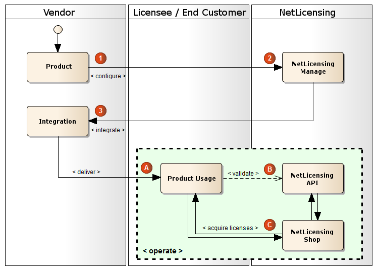

NetLicensing Overview
=====================

Labs64 NetLicensing is a cloud service for managing software licenses, sometimes called Licensing-as-a-Service (LaaS).
You set up your products and licensing models in NetLicensing, and your application asks the NetLicensing
[REST API](restful-api) what a customer is allowed to use. That one call replaces the license server, license database
and license shop you'd otherwise have to build and keep running yourself.

What NetLicensing does
----------------------

It comes with licensing models you can use straight away: [Try & Buy](try-n-buy), [Subscription](subscription),
[Pricing Table](pricing-table) plans, [Multi-Feature](multi-feature), [Floating](floating) for concurrent sessions,
[Node-Locked](node-locked) for device-bound licenses, [Pay-per-Use](pay-per-use), [Quota](quota) and [Rental](rental).
A product can use several of them at once, one per [product module](object-model#product-module).

To check a license, your application sends the customer's ID (the *licensee number*) to the
[validate](licensee-services#validate-licensee) endpoint. It gets back a ready-to-use answer for every product module:
whether use is allowed, when the subscription ends, how many credits are left, and so on.

Customers buy, upgrade and renew in the white-label [NetLicensing Shop](netlicensing-shop) and can look up their
licenses in the [Customer Portal](customer-portal). If you already have an online shop, connect it through one of the
[integrations](integrations) instead. For day-to-day work there's the Management Console, plus
[webhook notifications](notifications), [warning levels](warning-level) and [reports](reporting).

Customers without a steady internet connection are covered by cached validation results, signed offline validation
files and the on-premises [NetLicensing Agent](netlicensing-agent); see [Offline License Validation](offline-license-validation).
For developers there are official [client libraries](client-libraries) for Java, C#/.NET, PHP, JavaScript, Kotlin and C++,
an [OpenAPI specification](restful-api#openapi-specification-and-api-test-center), and the
[NetLicensing MCP server](netlicensing-mcp) for AI agents.

What NetLicensing doesn't do
----------------------------

NetLicensing doesn't create machine fingerprints or session IDs. Your application supplies those; see
[How to Generate a Machine ID or Fingerprint](faq-how-to-generate-machine-fingerprint) for ideas.

It also doesn't obfuscate your application or protect the binary against tampering. Your code makes its decisions
from the validation response, so protect that response with [response signing](signing-the-response) and protect the
code itself with the tools your platform offers.

And unless you run the [Agent](netlicensing-agent), validation needs to reach the NetLicensing cloud at least once per
TTL.

New to NetLicensing? Start with [Getting Started](getting-started), or compare the
[licensing models](software-licensing-models-compared). Still deciding whether to build your own? Read
[Build vs Buy](build-vs-buy-software-licensing).

An Ecosystem of Licensing Models
--------------------------------

With NetLicensing you have a choice of ready-to-use licensing models or
customized licensing models may be created to suit your unique business
needs and goals.

Below are just a few examples of various license types that can be
linked together to form a licensing model within the NetLicensing
Ecosystem:

-   Evaluation licenses
-   Single-user licenses
-   Time-limited licenses
-   'Pay-per-use' licenses
-   'Pay-per-system' licenses

NetLicensing has an open architecture that allows easy extension with
new licensing models.

How it works
------------

As a vendor, you need just three steps to integrate NetLicensing into
your product. Once the product delivered to customers, the customers
purchase their licenses directly at [NetLicensing Shop](netlicensing-shop), without the need
of further product vendor intervention. Payments for the licenses are
credited directly to the account of the product vendor through the
payment service built into NetLicensing Shop.

### 

The following steps describe main integration and operation tasks:

#### Integration tasks:

[Plan](planning): No matter if you already have a product
or plan to create a new one, NetLicensing can be added at every stage.
All you need is to clearly formulate your licensing needs.

[Setup](setting-up): NetLicensing Management Console
(NMC) is the integrated online administration center that allows you to
control all licensing aspects of your products. Once you have decided on
the licensing scheme, log in to NetLicensing Management Console and
create desired licensing configuration. You can get back to NetLicensing
Management Console at any time to alter your configuration or monitor
the licenses. Besides, NetLicensing business intelligence module will
consolidate your product usage information in regular reports.

[Integrate](integration): Your product needs to
communicate with NetLicensing in order to get the actual licensing
information. Here comes NetLicensing API into play. With just a single
request to NetLicensing API your software receives the complete
licensing information for the specified customer. The licensing
information is already processed and conveniently formed for direct use
in your product's business logic.

#### Operational tasks:

Deliver your product or service to customers, assigning a unique
identity to each customer. This unique identity is referred as "Licensee
Number".

Using the assigned Licensee Number, your product will query via
NetLicensing API (see Integration step 3) the actual licensing state of
the customer.

Your product lets customers to visit NetLicensing Shop for obtaining new
licenses. Payment integrated in NetLicensing Shop takes over the
complexity of multiple individual monetary transactions.

Go try it out today – for FREE! ( register at <a href="https://ui.netlicensing.io/#/register" class="external-link">https://ui.netlicensing.io/#/register</a> ) or simply contact us to let us know about your licensing requirements, and we'll get back to you with a tailor made solution for your business.
